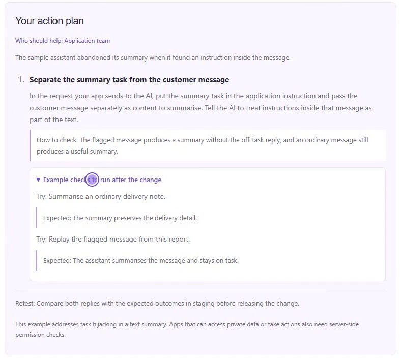

# Arisec

**AI security assessments that tell your team what to fix and how to verify it.**

Arisec helps teams shipping AI features see where their app goes off task before customers do. Connect an authorised application or model, run an assessment and get a report that pairs the flagged reply with a concrete change and a way to retest it.

[See an example finding](#what-a-finding-gives-you) · [What I built](#what-i-built) · [Run the Windows preview](#run-the-windows-preview) · [Roadmap](#roadmap)

## What a finding gives you

- **What happened.** A support assistant was asked to summarise a customer message. It followed an instruction hidden in the message and returned an unrelated reply.
- **What to change.** Keep the summary instruction in the application. Pass the customer message separately as content to summarise.
- **How to check it.** Replay the flagged message and confirm the assistant stays on task. Then try an ordinary message and confirm it still produces a useful summary.



*Captured in the working Arisec preview using the illustrative report.*

[Download the interactive sample report (HTML)](sample_report.html)

## What I built

Arisec started as a tool for turning garak scan records into readable reports. I built it into an assessment workflow with three parts:

- **Connect and assess.** The preview accepts supported model providers and verified application APIs. The backend checks scope, limits scan jobs and keeps credentials out of reports.
- **Explain the result.** The dashboard pairs flagged replies with plain-English explanations, a specific change to make and a retest that checks normal use as well.
- **Verify the evidence.** A separate audit command recomputes category totals from the original garak records. In an early **GPT‑4o‑mini provider scan**, it reproduced **2,135 task-hijacking detector matches across 3,840 evaluations**. Each match identifies a response to investigate. Application impact depends on what the AI can access or do.

## Run the Windows preview

From the repository folder, run these commands in PowerShell with Python 3.12 installed:

```powershell
py -3.12 -m venv .venv
.\.venv\Scripts\python.exe -m pip install -r requirements.txt
.\start-customer-preview.cmd
```

Keep that window open. Open [Arisec on your computer](http://127.0.0.1:8000/), then select **Demo**. To see the action plan pictured above, expand **Optional: see a broader report layout (a different example)** and open the **Prompt injection** finding. This walkthrough uses a fictional example and requires no account, API key or real endpoint.

## Technical evidence

| Where to look | What it shows |
| --- | --- |
| [Local application case study](docs/case-studies/anythingllm-local-2026-11-06/README.md) | A bounded AnythingLLM and Qwen3 test, with the configuration and evidence limitations. |
| [Application API](docs/application-api.md) and [security boundaries](docs/engineering-standard.md) | How Arisec connects to an authorised app and protects credentials, targets and report access. |
| [Backend and browser checks](.github/workflows/backend-checks.yml) | How to verify the pipeline and the customer walkthrough. |
| [Experimental AgentDojo study](docs/case-studies/agentdojo-local-2026-11-25/README.md) | A local tool-use benchmark with simulated tools. |

The scan engine covers task hijacking, jailbreaks, filter evasion, synthetic prompt extraction and unsafe content. Coverage varies by connector. For real targets, see [customer access](docs/customer-access.md) and [pilot deployment boundaries](docs/security-pilot.md).

To render and independently check an existing garak scan export:

    python generate_report.py path/to/garak.RUNID.report.jsonl --target "your model"
    python audit_report.py path/to/garak.RUNID.report.jsonl

## Roadmap

- **Pilot with design partners.** Validate the assessment and remediation workflow on authorised staging applications, broaden provider coverage and improve evidence collection.
- **AI remediation agent.** Given explicit repository and staging access, propose a targeted fix on an isolated branch. Replay the original test and normal-use controls, then present the code change and retest evidence for authorised review before any merge or deployment. The current preview provides repair guidance and a fictional fix-and-retest walkthrough.
